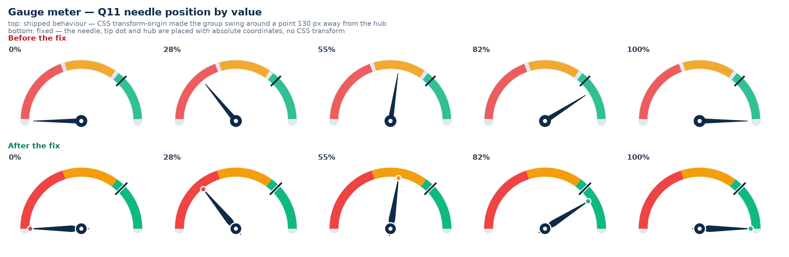

# Design system

Anaking is one platform with one visual language. This document is the contract: what the
tokens mean, which theme a screen uses, and how to add UI without re-introducing drift.

## Layers

| Layer | File | Owns |
|---|---|---|
| Tokens, base, chrome | `static/css/design-system.css` | palette, type, radii, elevation, motion, focus, app bar, footer, pills |
| App layouts | `home.css`, `workspace.css`, `studio.css`, `admin.css`, `survey.css` | page and component layout only |
| Context skins | `studio-workspace.css`, `studio-ai.css`, `preview-skin.css`, `explainer.css`, `nav.css` | small per-surface adjustments |
| Markup | `templates/_brand.html`, `_head.html`, `_nav.html`, `_footer.html` | the brand lockup, document head, section switcher, footer |

`design-system.css` is loaded **last** on every page. It settles tokens for the whole
cascade and owns the shared chrome, so an app stylesheet can style a component but can no
longer redefine the palette.

## Two themes, one system

```
default             team tools   workspace · studio · monitor · home · sign-in
.theme-instrument   respondents  the survey instrument
```

Both themes carry the same neutral ramp, type, spacing, radii, elevation, motion and
focus treatment. Only the accent and the paper warmth differ:

* **Team** — deep research green on warm paper. The working identity of the platform.
* **Instrument** — clinical navy blue on cool paper. A respondent should never mistake the
  questionnaire for team chrome, and the tested instrument keeps the look research teams
  approved.

Shells match the job: the simple entry pages (`home`, *study not launched*) and the Monitor
use the ink `.an-appbar`; the Workspace uses its sidebar; the Studio uses its own light tool
bar. All three read from the same surfaces, radii and type tokens.

The survey page sets `.theme-instrument` on `<body>`; the Studio's in-page preview uses
`preview-skin.css`, which mirrors that palette.

## Tokens

Everything is a CSS custom property on `:root`. Never write a raw hex value in a component.

```
--an-ink  --an-ink-soft  --an-muted  --an-faint        text
--an-line  --an-line-soft  --an-line-strong            borders
--an-paper  --an-panel  --an-panel-2                   surfaces
--an-accent  --an-accent-strong  --an-accent-bright
--an-accent-soft  --an-accent-tint  --an-accent-ink    accent ramp
--an-good  --an-warn  --an-bad  --an-violet            status (+ -soft variants)
--an-radius-xs|sm|(default)|lg|pill                    shape
--an-shadow-1|2|3                                      elevation
--an-font  --an-mono  --an-text  --an-leading          type
--an-control-h  --an-ring  --an-ring-offset            controls + focus
--an-ease  --an-fast  --an-mid                         motion
--an-z-nav  --an-z-overlay  --an-z-modal  --an-z-toast layering
```

The legacy names the older stylesheets use (`--ink`, `--accent`, `--accent2`, `--soft`,
`--teal`, `--radius`, `--shadow`, …) are **aliases** defined once in `design-system.css`
and resolve to the active theme's tokens. Adding a new alias is fine; re-declaring a
palette in an app file is not (a test enforces this).

One subtlety worth knowing: a custom property's `var()` references are substituted where
the property is *declared*. The alias map is therefore re-declared on `:root`,
`.theme-instrument` **and** `.survey-skin`, so an alias follows the palette of the scope it
is used in — an alias frozen only on `:root` would keep the team accent inside the
instrument.

## Shared components

* `.an-appbar` — the team app bar (brand + section switcher).
* `.appnav` / `.appnav-link` — Projects · Studio · Monitor, with `aria-current="page"` on
  the active one. The respondent survey is not a switcher tab: preview/test belongs to the
  Studio's ▶ Test survey and the per-study test/preview links. The test-mode team strip
  carries a `.teambar-testlink` "Test view" marker instead (return target for that study's
  test link).
* `.an-foot` — the shared footer on the team surfaces (Studio, Workspace, Monitor, the
  survey pages and the home page): cream ground, brand column plus three directory columns.
* `.lnf` — the landing page footer (`templates/_footer_landing.html`, styles in
  `landing.css`). A dark slab with five mint-headed link columns, a hairline, and a bottom
  rail for the app entrances, quick destinations, the team contact and the copyright. It is
  the only dark surface on the landing page below the hero stage, so the page closes with a
  deliberate full stop instead of another cream panel. Every link there targets a page or
  anchor that exists; the search-alias line is kept from the shared footer.
* `.pill` — one status pill for every app; variants are semantic
  (`live`, `draft`, `closed`, `test`, `complete`, `in_progress`, `screened_out`, …).
* `.linkbtn` — secondary action inside a bar.
* `.skip-link`, `.sr-only`, `.an-eyebrow` — utilities.

## The Admin account desk

`/admin/console` is the platform admin's working surface, not a second dashboard. It is a
master/detail **desk**: the roster on the left is an index of people; the pane on the right
is one person's whole context.

```
roster (search · status filters)   passport → metrics → tabs
                                   Overview   identity · access · role · delete
                                   Projects   status · Studio · Monitor · transfer
                                   Kart       limit, ledger, open requests
                                   Activity   the audit trail for this account
```

Rules that keep it honest:

* **Nothing destructive is one click away.** Deleting an account is blocked while it owns
  projects (transfer or delete them first); the master admin cannot be deleted, demoted or
  paused anywhere in the UI or the API.
* **The Kart is a ledger, never a silent number.** Every admin change writes a reason and an
  actor into `point_transactions`, which the Kart tab renders as a table.
* **The support view is visible and reversible.** "Open as *person*" swaps the session to
  that account for one purpose — seeing what they see — and renders `.support-strip` on
  every team page (design-system chrome) with the way back. The admin desk is out of reach
  while a support view is open, every action still lands in the audit trail as the admin,
  and admin accounts can never be opened this way.
* The tokens are the shared ones: the desk is warm paper + ink + the green accent, with the
  gold admin note (`--an-warn`) reserved for "this needs your decision".

`static/css/console.css` owns layout only; `.support-strip` lives in `design-system.css`
because it is shared chrome.

### Sign-in recovery on the desk

Two places, one rule — a recovery link is always **shown to the admin, never to the person who
asked**:

```
SIGN-IN RECOVERY            request → Create link · Handed over · Revoke
  (row per queued request)  fresh link appears in .adk-linkbox with a Copy button

account → Overview → Sign-in & recovery
  username · e-mail · signs in with · password set
  Create a one-time link   → .adk-linkbox (copy) + recent requests
```

* The queue is a `.adk-recovery` band above the desk (same warm card + green accent as the
  roster, no new colours; the left rule is `--an-accent`, not `--an-warn`, because it is
  waiting on *you*, not urgent). It only renders when something is queued — the desk stays
  quiet otherwise.
* A queued row never reveals a token: tokens are stored hashed, so **Create link** mints a
  fresh one (superseding the old) and drops the copyable URL into `.adk-linkbox`. **Handed
  over** closes the request without invalidating the link; **Revoke** kills it.
* The same block explains *why* the queue exists (no SMTP) so the admin is not left guessing,
  and the account's last four requests are listed with their state (`pending`,
  `e-mailed`, `handed over`, `used`, `superseded`, `revoked`).
* `.adk-kvlist` is the label/value list inside the card: uppercase micro-labels, right-aligned
  values, wrapping rather than truncating e-mail addresses.

## Brand

`templates/_brand.html` renders the lockup (mark, wordmark, badge, tagline). Pass the badge
for the surface (`STUDIO`, `MONITOR`, `SURVEY`, `WORKSPACE`, …). Never copy the SVG into a
page — a test fails if a second copy appears.

The mark is an **ivory cameo tile with a cut-green gem**: warm paper tile (`#f6f1e8`, taupe
keyline) carrying a four-facet gem in the platform's green ramp (`#3aa886 → #124a3c`) with
an ivory glint. It was chosen for contrast, not decoration — the tile reads on the dark app
bar, the navy/violet survey bar, paper and white alike, where the old near-black tile with
neon facets disappeared against dark bars and mushed at small sizes. Companion rules:

* The wordmark is **solid** (`--an-ink`, white on dark bars). No gradient text — it muddies
  below 20px and washes out on dark chrome.
* The badge is a calm pill (`--an-accent-soft` / accent, translucent white on dark bars)
  with a **live indicator**: a breathing dot that pings an expanding ring.
* **The living gem** — the mark's "live" feel is three calm, perpetual motions (all CSS,
  all collapsed under `prefers-reduced-motion`):
  * `akSheen` — a light sweep crossing the tile every 7s, like light moving over a cut
    stone (clipped to the tile, soft white gradient);
  * `akFloat` — the gem breathes with a ~1.3px float;
  * `akOrbit` — a small gold spark (`#c9a227`, the identity's single metallic note)
    orbits the gem every 11s.
  Hover lifts the lockup with a spring, brightens the stone and runs the sweep faster.
  No neon, no glow — motion, not noise.
* Tests ban the old neon palette (`#00f5a0`, `#00d9f5`, `#7928ca`, `#38bdf8`, …) and
  gradient text anywhere in CSS, so the look cannot silently regress.

## Assets

Templates call `asset('css/survey.css')`, never a literal path. The helper stamps every URL
with `app.config["ASSET_VERSION"]` — the newest mtime in `static/` (override with the
`ASSET_VERSION` environment variable in a fixed deployment). Editing a stylesheet or script
therefore busts browser caches on the next start, with no hand-typed `?v=` strings.

## Rules for new work

1. Use `var(--an-*)` tokens; no raw hex, no one-off radii or shadows.
2. Load `design-system.css` last and add only layout rules to an app stylesheet.
3. Give every page: the `head()` macro, a skip link, one `<h1>`, and the section switcher
   with `aria-current`.
4. Keep touch targets ≥ 40px and let the shared `:focus-visible` ring show — never remove it.
5. Respect `prefers-reduced-motion` (the base layer already collapses animations).
6. `tests/test_design_system.py` enforces the contract: one token file, one brand macro, one
   asset stamp, consistent chrome on every page.

## Gauge meter geometry

The gauge question type, the landing-page demo dial and the workspace "answer view" dial
all draw the same dial: a 260×260 SVG viewBox, hub at `(130, 130)`, an arc band split into
three zones and a needle `<g>` rotated from −90° (left, 0) to +90° (right, 100).

Two rules keep the needle honest:

1. **One rotation model per element.** The needle points along −y and is rotated with
   `<g transform="rotate(angle 130 130)">`. The CSS for that group must not set
   `transform-origin`; an SVG presentation `transform` becomes a CSS transform in current
   browsers, so a CSS origin of `130px 130px` *wraps* the attribute rotation and the needle
   pivots about `(260, 260)` — off the hub, outside the dial.
2. **Geometry is computed once.** `chart-visuals.js` owns the value→angle mapping and the
   zone thresholds (40 / 70); the survey question, the landing demo and the studio thumbnails
   all call it, so a value never renders at a different angle in two places.



*Top row: the shipped behaviour. `transform-origin` compounded with the SVG rotation, so the
pivot slid off the hub and the needle swung by roughly twice the intended angle — 0% pointed
right, 55% only looked correct by accident and 82% pointed back to the left. Bottom row: the
fix, each value landing where the scale says it should.*

The landing demo dial additionally follows the pointer only while the visitor is dragging
(or using the arrow keys) and eases back to a representative value when idle, so the page
never looks frozen.

## The Studio preview skin

`static/css/preview-skin.css` is **generated** — never edit it by hand:

```
python3 scripts/build_preview_skin.py          # regenerate from survey.css
python3 scripts/build_preview_skin.py --check  # CI-friendly drift check
```

It scopes the survey structure under `.survey-skin` and carries **no palette**: the scope is
declared next to `.theme-instrument`, so the question-test view and the live preview borrow
the instrument tokens directly and cannot drift from the real questionnaire. A test fails
if the checked-in file is stale.

## Known follow-ups

* `survey.css` still contains literal colours from the instrument's original build. They
  match the theme tokens today; folding them into `var(--an-*)` is a follow-up.
